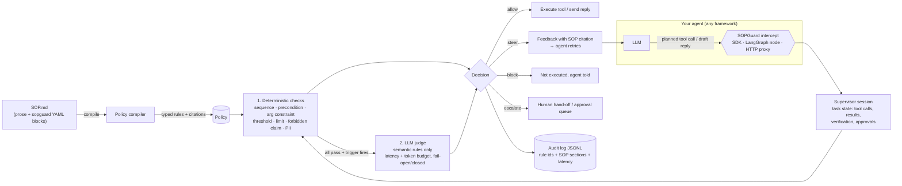

# SOPGuard architecture

## Request path

1. The agent proposes a step: a tool call (`issue_refund(order_id, amount)`) or a reply to the customer.
2. The integration (SDK decorator, LangGraph `SupervisedToolNode` / `ReplyGuardNode`, or the
   OpenAI-compatible proxy) hands it to the supervisor **before** it has any effect.
3. Deterministic rules run against the tracked task state. They are cheap (well under 1 ms) and exact:
   ordering (`lookup_order` before `issue_refund`), preconditions (`verified(order.customer_id)`), argument
   constraints (`args.amount <= order.total - refunded`), approval thresholds, limits, forbidden claims
   (`"refund has been issued"` unless a refund tool call actually succeeded) and PII (values from tool
   results, owner-aware, plus card/email/phone/address detectors).
4. Only if they all pass, and only for semantic rules whose cheap trigger prefilter fires, the LLM judge is
   asked. It sees the transcript as untrusted, quoted data. Each semantic rule declares what happens if the
   judge is slow or down (`fail_mode: open|closed`).
5. The strictest action wins: allow < steer < block < escalate. Repeated steering on the same step becomes
   an escalation (steer budget), so a stubborn agent cannot loop forever.
6. Every decision is appended to the audit log with the rule ids, the SOP section each rule came from,
   the policy hash, latency and judge tokens.

## Missing state is not a pass

Policy expressions are evaluated by a whitelisted AST interpreter. Reading a field of something that does
not exist yet (e.g. `order.status` before the order was looked up) raises `MissingFact`, which becomes a
violation ("cannot verify policy"), never a silent pass. Expression errors fail closed (escalate).

## Integration surfaces

| Surface | Where | How a steer reaches the model |
|---|---|---|
| Python SDK | `sopguard.sdk.Guard` | blocked tool returns `{"error", "supervisor": feedback}` (or raises) |
| LangGraph | `sopguard.adapters.langgraph` | `ToolMessage(status="error")` with feedback; reply guard routes back to the agent |
| HTTP proxy | `POST /v1/chat/completions` | proxy re-asks upstream with a system message carrying the feedback |
| HTTP API | `/v1/sessions/{id}/check/*` | caller decides |
