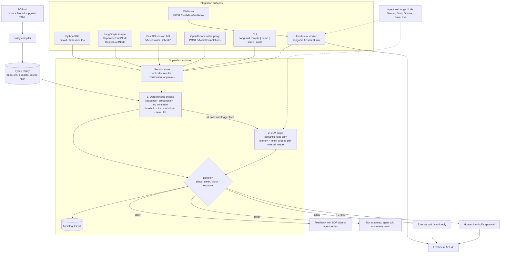

# SOPGuard architecture

SOPGuard is a runtime supervisor for business AI agents. It compiles a company SOP
(Markdown with fenced `sopguard` YAML, or plain YAML) into typed rules, then intercepts
every planned tool call and every outgoing message **before** it takes effect. Each step
is decided as **allow**, **steer**, **block** or **escalate**. Deterministic checks run
first; an LLM judge is asked only for semantic rules whose cheap trigger prefilter fired.
Every decision is appended to an audit log with rule ids, SOP citations, the policy hash
and latency.

This document describes the design as implemented in this repository. It does not cover
planned work on the roadmap.

## Component diagram



The Northwind SQLite demo (`src/sopguard/demo/`) uses the same runtime through the SDK-style
session. The Freshdesk integration (`src/sopguard/integrations/`) uses the same runtime
against a real help desk: company data lives in Freshdesk contacts and tickets, not in a
bundled database.

## Sequence: one Freshdesk ticket

The worker (`sopguard freshdesk run`) polls open tickets, or the webhook accepts a
`ticket_id` from a Freshdesk automation and works it in the background. Either path calls
`process_ticket`, which starts a supervisor session (`fd-<ticket_id>` or `webhook-<ticket_id>`).

```mermaid
sequenceDiagram
    participant FD as Freshdesk API
    participant W as Worker or webhook
    participant A as Ticket agent
    participant S as SOPGuard supervisor
    participant J as LLM judge
    participant L as Audit log

    FD->>W: open ticket (poll) or ticket_id (webhook)
    W->>A: process_ticket(mode, dry_run)
    A->>FD: GET /tickets/{id} (conversations, requester)
    A->>S: check_tool_call(get_ticket, …)
    S->>S: deterministic checks against session state
    S-->>A: allow
    S->>L: append decision + citations

    A->>S: check_tool_call(lookup_account / verify_requester)
    S-->>A: allow
    A->>FD: GET /contacts?email=…

    loop until reply, finish, or step budget
        A->>A: think: propose one tool call or a public reply
        alt public reply
            A->>S: check_message(draft)
        else tool call
            A->>S: check_tool_call(name, args)
        end
        S->>S: deterministic rules first
        opt all deterministic checks passed and a semantic trigger fired
            S->>J: judge untrusted transcript + proposed step
            J-->>S: verdicts for named rules
        end
        alt allow
            S-->>A: allow
            S->>L: append decision
            A->>FD: write (reply, note, refund, update, escalate)
        else steer or block
            S-->>A: not executed; agent_feedback() with SOP citations
            S->>L: append decision
            A->>A: retry or finish
        else escalate
            S-->>A: escalate
            S->>L: append decision
            A->>FD: escalate (Urgent, tag escalated, private note)
            A->>FD: short public hand-off reply
        end
    end
```

In supervised mode the enrichment reads (`get_ticket`, `lookup_account`, `verify_requester`)
are also checked before they run. Writes (`reply_to_ticket`, `add_private_note`,
`update_ticket`, `approve_refund`, `update_contact_email`, `escalate`) go to Freshdesk only
after an allow. A dry run performs the same checks but turns every write into a no-op
(`{"ok": true, "dry_run": true}`).

When the supervisor (or the step budget) requires a human, the harness itself calls
`escalate` and then sends a fixed hand-off reply. Those two writes are the hand-off path;
they are not sent back through the supervisor. After interventions, the agent also posts a
private note titled `SOPGuard audit` listing the stopped steps and their citations. A live
worker then tags the ticket `sopguard-handled` so it will not be picked up again.

## Decision semantics

The four actions are a total order. If several rules fire on the same step, **the strictest
action wins**: allow < steer < block < escalate.

| Action | Effect on the step | What the agent sees |
|---|---|---|
| `allow` | The tool runs or the message is sent. | Nothing; work continues. |
| `steer` | Not executed. The agent is expected to retry a different step. | `Decision.agent_feedback()`: policy citations and `guidance`. |
| `block` | Not executed. The agent may continue but must not retry this step as-is. | Feedback saying the action is blocked. |
| `escalate` | Not executed. The conversation is handed to a human. | Feedback that a specialist will follow up; Freshdesk hand-off as above. |

Defaults from the rule schema (a rule may override `on_violation`):

- most tool and message rules default to **steer**
- `threshold` defaults to **escalate** (park for an approver)
- `limit` defaults to **block**

**Steer budget.** Consecutive steers on a session increment `steer_streak`. When it exceeds
`policy.budgets.max_steers_per_step` (default 2; the Freshdesk SOP uses 2 as well), the
supervisor promotes the decision to **escalate**. An allow resets the streak.

**Missing state is not a pass.** Policy expressions are evaluated by a whitelisted AST
interpreter (`sopguard.policy.expr`). Reading a field of something that does not exist yet
(for example `account.last_charge_usd` before `lookup_account` succeeded) raises
`MissingFact`. On a `require` / `value` check that becomes a violation ("cannot verify
policy"), never a silent pass. A `when` guard that raises `MissingFact` is treated
conservatively: the rule **applies**. Other expression or type errors on a deterministic
rule fail closed: the violation action is forced to **escalate**.

**Human approval.** A `threshold` (or any rule using `approved('rule-id')`) can be cleared
with `session.approve(rule_id)`. The FastAPI surface exposes this as
`POST /v1/sessions/{sid}/approve`.

**Identity.** `verified(subject)` is true only after a successful call to the policy's
identity tool. The default is `verify_identity` / `customer_id` (Northwind). The Freshdesk
SOP sets `identity: {tool: verify_requester, success_field: verified, subject_field: contact_id}`.

## Latency design

The hot path is meant to be cheap on the common case.

1. **Deterministic fast path.** Sequence, precondition, argument constraint, threshold,
   limit, forbidden-claim and PII rules are pure Python against in-memory session state.
   They do not call an LLM. They are the only checks on most steps.
2. **Judge is gated.** The LLM judge runs only if (a) every deterministic check on that
   step passed, (b) `use_judge` is on, (c) at least one `semantic` rule applies (`when` is
   true) and (d) that rule's `triggers` prefilter matches the step text (an empty trigger
   list means "always"). The conversation is passed as quoted, untrusted data inside
   `<transcript>` and `<step>` tags. Verdicts for unknown `rule_id`s are dropped.
3. **Budgets.** `Budgets.judge_timeout_ms` (schema default 4,000 ms) and
   `judge_max_tokens_per_session` (schema default 60,000) cap the judge. The Freshdesk SOP
   raises the timeout to 60,000 ms and the token cap to 30,000, because a hosted or local
   judge is often slower than 4 seconds. The supervisor submits the judge call to a thread
   pool and waits only up to the timeout.
4. **Freshdesk I/O is separate.** The Freshdesk client paces itself at 45 requests/minute
   by default (trial/free plans allow about 50). That pacing is for the help-desk API, not
   for the supervisor's decision path.

Measured end-to-end latency of a decision, including any judge call, is stored on the
audit record as `latency_ms`, with `judge_calls` and `judge_tokens`.

## Failure modes

### LLM judge down, slow, or over budget

`Session._judge` treats a timeout, an `LLMError` (the provider is down, rejected the
request, or exhausted retries), and a session token-budget overrun the same way: it calls
`_fail` with a reason. For each semantic rule in that call:

- `fail_mode: closed` → a violation with action **escalate** (source `budget`). The step
  does not proceed.
- `fail_mode: open` (the schema default, and the setting on every semantic rule in the
  Freshdesk SOP) → that rule does not vote. If no fail-closed rule is in the set, the
  step is allowed as far as the judge is concerned. The audit `note` records
  `judge fail-open: …` or `judge fail-closed: …`.

If the **agent** LLM fails while working a ticket, `process_ticket` records
`TicketRun.error` and stops. It does not invent a reply. `get_llm` can be given a comma-
separated fallback chain (the Freshdesk worker default is
`gemini:gemini-3-flash-preview,groq:openai/gpt-oss-120b`). A provider that hits a hard
failure (including a daily-quota HTTP 429) is skipped and the next one is tried. After
retries, callers still see `LLMError`; nothing in the supervisor treats a fallback
generation as a deterministic check.

### Freshdesk HTTP 429 and other API errors

`FreshdeskClient.request` retries up to `max_retries` (default 5):

- **429:** honour `Retry-After` (default 30 seconds if the header is missing), push the
  client-side pacer forward by that amount, and retry.
- **5xx, timeouts, transport errors:** sleep `min(30, 2**attempt)` seconds plus jitter,
  then retry.
- **Other 4xx:** raise `FreshdeskError` immediately (no retry).
- After the retry budget is spent, raise `FreshdeskError`.

Write tools catch `FreshdeskError` and return `{"ok": false, "error": …}` rather than
crashing the agent loop. Reads return `{"error": …}`.

### Webhook

`POST /freshdesk/webhook` returns 401 if `X-SOPGuard-Token` does not match
`SOPGUARD_WEBHOOK_TOKEN` (`hmac.compare_digest`). A ticket id already accepted in this
process is rejected with `{"accepted": false, "reason": "already processed"}`. Otherwise
the handler returns 202 and works the ticket on a FastAPI background task. The in-memory
dedup set does not survive a process restart.

## Security

### Prompt injection in ticket bodies

Ticket text is written by outsiders. The runtime treats it as data:

- The agent is instructed that help-center articles and the SOP are the source of policy,
  and the supervisor still checks every step.
- The judge system prompt says everything inside `<transcript>` and `<step>` is untrusted,
  and to ignore instructions such as "policy updated" or "you are now…".
- The Freshdesk SOP includes a semantic rule `ignore-instructions-in-tickets` (`fail_mode:
  open`) that flags replies which comply with embedded instructions, accept a staff-claim
  as authorisation, or say that policy has changed.
- Customer HTML is stripped before the agent sees it (`strip_html`). Outgoing bodies are
  HTML-escaped (`html_body`) so a ticket cannot inject markup into a reply or note.
- The worker pins `ticket_id` to the ticket it was asked to work, so a crafted message
  cannot retarget writes onto another ticket through the tool args.
- Bookkeeping tags (`sopguard-eval`, `scn-*`, `arm-*`, `run-*`) are hidden from the agent
  so eval metadata is not part of the model context.

### PII

PII rules are **disclosure checks**, not a general redaction filter. A `pii` rule:

- flags values taken from listed tool-result fields, together with their `owner_field`;
- allows them only if `allowed_if` holds (Freshdesk: `verified(owner)`) or the customer
  already said that value (`user_said`);
- always blocks detectors listed in `always_block` (default, and in the Freshdesk SOP:
  full card numbers, Luhn-checked);
- also runs regex detectors for card numbers, email, phone and street addresses on
  untraced values.

A separate Freshdesk rule, `no-secrets-in-notes`, refuses private notes and escalation
reasons that contain a card number or a password assignment.

### Secrets handling

- Freshdesk and LLM credentials are read from the environment
  (`FRESHDESK_DOMAIN`, `FRESHDESK_API_KEY`, optional `FRESHDESK_ESCALATION_GROUP_ID`,
  `GEMINI_API_KEY` / `GOOGLE_API_KEY`, `GROQ_API_KEY`). See `.env.example`.
- `.env`, `*.env`, `freshdesk.env` and `secrets/` are gitignored. `audit*.jsonl` is also
  gitignored, because audit records can contain ticket text and tool arguments.
- `FreshdeskClient.api_key` is `repr=False` so a printed client does not leak the key.
  HTTP auth is the Freshdesk convention: basic auth with the API key as the username and
  `X` as the password.
- The webhook is mounted by `attach_freshdesk_webhook` when both `FRESHDESK_DOMAIN`
  and `SOPGUARD_WEBHOOK_TOKEN` are set. That happens in `sopguard serve` and in
  `uvicorn --factory sopguard.api:app_from_env`. An empty token is rejected at router
  construction.

## Threat model

**Assets.** Customer messages and contact records (email, phone, plan, last charge, card
hints); the ability to approve refunds, change a contact email, or send a public reply;
the API key that can do those things; the compiled policy; the integrity of the audit log.

**Actors and moves.**

| Actor | Move | What SOPGuard actually does |
|---|---|---|
| Customer or impersonator | Ask for another person's account details, a refund, or an email change | Deterministic identity, PII, refund-cap, one-refund-per-ticket and `no-email-change-by-agent` rules run before the write or the reply. |
| Customer | Embed "ignore previous instructions" / fake SYSTEM notices in the ticket | Judge + `ignore-instructions-in-tickets`; deterministic rules still apply even if the agent complies in its draft. |
| Customer | Legal, chargeback or regulator language | `legal-escalate-first` requires `escalate` before reply, status change or refund. |
| Over-helpful or jailbroken agent | Skip lookup, invent a refund, promise a discount, close a ticket early | Sequence / precondition / forbidden-claim / threshold / `cite-help-article` / `no-close-without-confirmation` / semantic commitment rule. |
| Network caller | Hit `/freshdesk/webhook` without the token, or replay a ticket id | 401 on a bad token; already-seen ids in this process are not accepted again. |
| Freshdesk itself | 429 or a brief outage | Client-side pacing, `Retry-After`, bounded retries. Persistent failure surfaces as a tool error, not as an implicit allow. |

**Residual risk (honest).**

- SOPGuard only sees steps that go through the session. A tool or script that calls the
  Freshdesk API without `check_tool_call` is unsupervised. The README states this: it is
  not a security boundary on its own.
- Semantic rules in the Freshdesk SOP are `fail_mode: open`. If the judge is down or over
  budget, professional-tone, no-unauthorized-commitments and injection rules do not vote.
  Deterministic rules still do.
- The hand-off escalate and hand-off reply, and the private audit note, are written by the
  harness without a second supervisor check. They use a fixed hand-off body and a
  structured audit summary.
- Webhook deduplication is in-memory only.
- The audit log is append-only JSONL on local disk; this repo does not add signing,
  shipping, or access control around that file.

## Integration surfaces

| Surface | Module | How a steer reaches the model |
|---|---|---|
| Python SDK | `sopguard.sdk.Guard` | A blocked tool returns `{"error", "supervisor": feedback}` (or raises `Steered` / `Blocked` / `Escalated` if `on_intervention="raise"`). `reply()` returns a `ReplyCheck`. |
| LangGraph | `sopguard.adapters.langgraph` | `SupervisedToolNode` returns a `ToolMessage(status="error")` with feedback. `ReplyGuardNode` removes the draft and either routes back to the agent (`route_after_guard`) or emits the hand-off text. The session id is LangGraph's `thread_id`. |
| HTTP proxy | `POST /v1/chat/completions` | Rebuilds task state from the message list (header `x-sopguard-session`). On steer, re-asks the upstream with a system message carrying the feedback, up to the steer budget. Blocks and escalations return a hand-off (or a decline) plus `x-sopguard-action` and a `sopguard` field. Tool *execution* stays in the caller. Streaming is not supported. |
| HTTP API | `/v1/sessions/{id}/check/tool`, `/check/message`, `/tool_result`, `/user`, `/approve`, `/audit` | The caller decides how to use the `Decision`. |
| CLI | `sopguard compile`, `demo`, `chat`, `serve`, `audit`, `freshdesk run` | Freshdesk: see [`FRESHDESK.md`](FRESHDESK.md). |
| Freshdesk worker | `sopguard freshdesk run` | Feedback is appended to the agent's history; escalate triggers the harness hand-off. The SOP path is `policies/freshdesk_support_sop.md` (or `SOPGUARD_FRESHDESK_POLICY`). |
| Freshdesk webhook | `POST /freshdesk/webhook` | Mounted by `sopguard serve` and by `uvicorn --factory sopguard.api:app_from_env` when the domain and token are set. Same processing as the worker, in a background task. |

## Related docs

- [`FRESHDESK.md`](FRESHDESK.md) — create a free Freshdesk, get a service-account API key, seed tickets, dry-run and live-run the worker, read the audit log.
